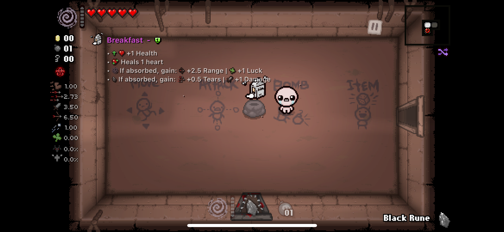
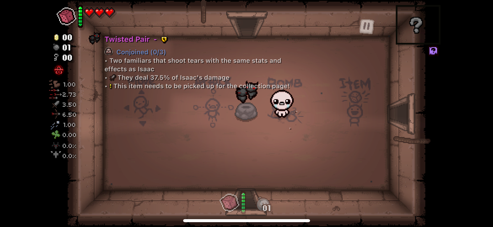
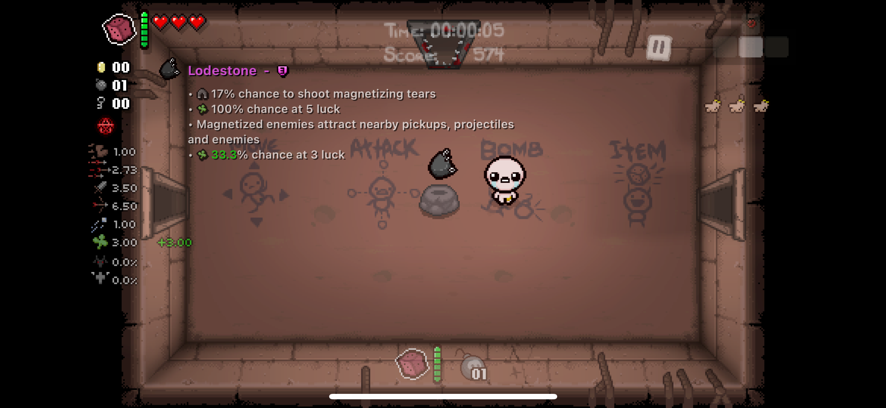
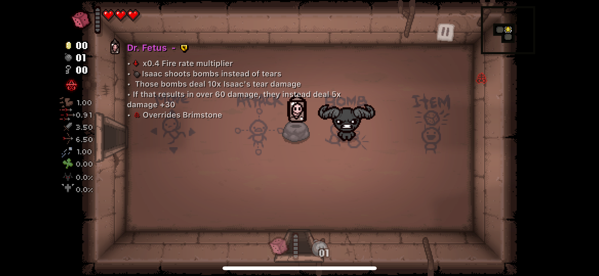
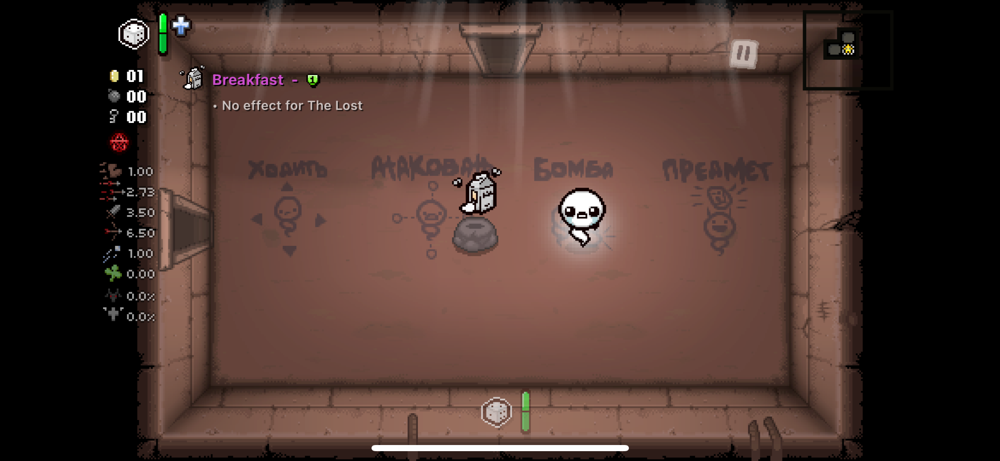

# Isaac External Item Descriptions for iOS

The first publicly released native gameplay mod for **The Binding of Isaac: Repentance on iOS**. It brings External Item Descriptions-style information to the native iOS game without relying on Isaac's desktop Lua mod API.


The same ARM64 implementation supports jailbroken injection, direct app-bundle embedding, and LiveContainer private apps. The dylib itself is portable: ElleKit is used only by the optional jailbreak package as a loader.

## Download

Download the current files from [GitHub Releases](https://github.com/emp0ry/IsaacExternalItemDescriptionsiOS/releases/latest).

| Installation | Release file | Included |
| --- | --- | --- |
| Rootless jailbreak with ElleKit | `IsaacExternalItemDescriptions-rootless.deb` | Dylib, loader filter, descriptions, icons, and transformation data |
| LiveContainer private app | `IsaacExternalItemDescriptions-LiveContainer.framework.zip` | App-specific framework with all required resources |
| Embedded/non-jailbroken app | `IsaacExternalItemDescriptions-Embedded.zip` | Dylib and complete `IsaacEID.bundle` for app-bundle injection |
| Advanced/manual setup | `IsaacExternalItemDescriptions-Full-Build.zip` | Every build format, database, documentation, and checksums |

A standalone `IsaacExternalItemDescriptions.dylib`, `descriptions.json`, and `SHA256SUMS` are also provided. No Isaac IPA or copyrighted game bundle is distributed.

### What's new in v0.10.1

- **Readable pause descriptions:** selecting an item in **EID Items** always
  gives it a dark background, even when Background is disabled. The temporary
  pause-inventory backdrop is at least 72% opaque; saved gameplay settings stay
  unchanged and return when the run resumes.
- **Content-sized backgrounds:** the box fits the actual title and widest
  laid-out text line, including icons and the preview counter. Short descriptions
  no longer retain a long default-width box. Text size is unchanged.
- **D Infinity description browser:** select it in **EID Items**, then tap the
  description to inspect all ten dice. The top-right `0/10 ›` counter starts at
  D Infinity's overview and returns there after D100. This only changes the
  displayed description, never the game's selected die or charge.

Read the [v0.10.1 release notes](docs/RELEASE_NOTES_v0.10.1.md) and
[pause-description checks](docs/testing-pause-descriptions.md).

### Previous update: v0.10.0

- **Glitched Crown:** inspect the pedestal's real five-item cycle without chasing
  its flashing sprite. Tap the description to advance; `0/5 ›` sits inside the
  header's top-right corner. Each item keeps its own full description and previews.
- **Abyss:** see the original standard-Repentance locust count, damage, size,
  speed, and special effects before absorbing a collectible.
- **Wild Card and Vurp!:** see the recorded effect Wild Card will repeat and the
  pill Vurp! will produce, with localized names and actual pill-color artwork.
- **The Stars?:** preview the oldest eligible passive item it will remove, or two
  items with Tarot Cloth, using native pickup history and current ownership.
- **Black Feather:** show the live qualifying-item count and damage bonus,
  including duplicate items, qualifying trinkets, Mom's Box, and golden Feather.
- New previews use the game's native state, retain unknown/blind protections,
  and support all 20 EID languages with English fallback. Existing Spindown,
  absorption, character, inventory, and LiveContainer fixes remain included.

Read the [complete v0.10.0 release notes](docs/RELEASE_NOTES_v0.10.0.md) for
behavior and verification limits. Earlier additions are documented in the
[v0.9.0 notes](docs/RELEASE_NOTES_v0.9.0.md) and [v0.8.0 notes](docs/RELEASE_NOTES_v0.8.0.md).

## Features

### Descriptions

- Collectibles and trinkets
- Cards and runes
- Identified pills and horse pills
- Crane Game prizes
- Dice Room effects for all six faces
- The next Sacrifice Room payout with the live step from `1/12` through `12/12`
- Complete Repentance description data for all 20 upstream EID languages, with English fallback for untranslated entries

The overlay tracks the player's position and displays the nearest eligible object. Long descriptions wrap normally and are not cut to a fixed character count.

### Correct knowledge and run state

- Card, rune, Soul Stone, and pill visibility follows original EID's separate defaults instead of treating `Touched` as a universal knowledge flag.
- Reachable ordinary floor cards and runes are described immediately. Shared-model shop cards and every `Options?` card stay unidentified. Unique models (Credit Card, Card Against Humanity, Get Out of Jail Free Card, Emergency Contact, Dice Shard, Holy Card, Black Rune, Rune Shard, Cracked Key, Wild Card, and Soul Stones) may be described even in shops or behind obstacles. Chaos Card shares a model with other green cards and is not an exception.
- Reachable pills are shown in shops and `Options?` choices. Isaac's native ItemPool state decides whether the real effect or only a localized **Unidentified Pill** label may be shown.
- Unreachable shared-model cards, runes, and pills remain unidentified. Visually distinct cards retain their exception, and flying players bypass the obstruction check.
- Collection-page reminders use Isaac's live `PersistentGameData` for the selected save slot, not current-run inventory or another slot's progress. Hidden collectibles, pause-inventory entries, and read-only/custom runs do not show this reminder. The native table updates after a legitimate pickup; no separate progress database is written.
- PHD and False PHD identify pills. Known effects are obtained from the game's player-specific `GetPillEffect` on the main thread after live-player validation, including Virgo/Lucky Foot conversions and native low-health exceptions. False PHD adds `+0.6` damage (`+1.2` for horse pills) or a black-heart reward only for the appropriate resulting effects. Unknown pills reveal neither effects nor synergy bonuses.
- Curse of the Blind suppresses every collectible description using the native level curse mask. The forced-blind field and question-mark sprite are retained as additional guards.
- Transformation progress combines Isaac's persisted PlayerForm counters with the live owned-item table. It updates immediately after a pickup while still preserving progress across active-item replacement and save reloads.
- The 14 normal transformations use the native counters and inventory state. Super Bum completion is read from its native merged familiar.
- Puberty/Adult and other identified pill transformations use the persisted counters, including horse pills. Unknown pills never expose transformation information.
- Transformation counters retain the actual count after completion, so progress can display `4/3` and higher.
- Static character-specific EID rules adjust descriptions for the nearest player, including Lost/Keeper no-effect and lethal-use warnings, health-type replacements, and Birthright effects.
- Additional character context includes Eye Drops, Tainted Samson/Uranus, Keeper/IV Bag, tainted Clicker, Dead Cat, and Lilith/Tainted Lilith BFFS! effects. Co-op differences are annotated and pause ownership checks use the primary player's inventory.
- Tainted Cain pedestals show salvage information with room-pool rewards, Birthright and trinket bonuses, while protecting quest items and special contexts.
- Book of Virtues previews wisp stats and special effects; Judas' passive Birthright Book of Belial adds active-item bonuses.
- Greed and Greedier use upstream mode-specific descriptions and room-to-wave wording where supported.
- Weapon descriptions warn when an owned item overrides a pickup's effect, and in the reverse direction when the pickup would override an owned item. Repentance weapon priorities and special synergies follow original EID, including Dr. Fetus/Trisagion, Epic Fetus, Brimstone, Mom's Knife, Tech X, C Section, Spirit Sword, and Azazel's native weapon.
- Car Battery and Tarot Cloth apply original Repentance conditional descriptions, including numeric effect changes, special behavior, and no-synergy active items.
- Golden trinkets and Mom's Box use upstream's per-trinket multipliers, custom replacements, and translated bonus text; changed values are highlighted in gold.
- Luck-sensitive effects show the current player's actual proc chance using the original standard-Repentance formulas and native Luck value.
- Spindown Dice previews three uses using the same native availability check as the iOS effect. Locked, run-restricted, missing and hidden IDs are skipped completely; only actual eligible results are displayed. The chain accounts for Car Battery, stops at Dad's Note, and shows item disappearance. Unlocks are checked separately from collection-page ownership.
- Blank Card, Clear Rune, and Placebo show the displayed card/rune/identified pill's mimic charge cost from the installed game's XML. Unknown pills do not reveal costs; Blank Card + Tarot Cloth has its additional upstream notes.
- Flip reads the native alternate-pedestal record and previews its item and description, without bypassing blind-item protection. It remains included in the build; live device verification is pending.
- Void and Black Rune preview stat gains from copied native RNG and the authoritative room entity list. Room, purchased-item, and single-item cases use separate predictions; a missing/invalid native snapshot suppresses the forecast instead of guessing.
- Abyss appends original standard-Repentance locust information for the selected player's owned active, including 17 special definitions and the normal-locust fallback. Repentance+ quality scaling is not applied. See [Abyss checks](docs/testing-abyss.md).
- Wild Card and Vurp! read native persisted use history for localized effect/pill previews, including normal/horse pill behavior and player-specific effects. See [repeat-preview checks](docs/testing-repeat-previews.md).
- The Stars? reads native pickup order and removal eligibility, including Tarot Cloth's second item. Black Feather counts qualifying collectible copies and trinket multipliers for its live bonus. See [inventory-preview checks](docs/testing-inventory-previews.md).
- Glitched Crown reads the native cycle queue. Tap its description to move from overview (`0/5 ›`) through each individual item and back; selection remains stable while the sprite rotates. Native rerolls update the list, separate pedestals have separate selections, and blind items stay hidden. See [Crown checks](docs/testing-glitched-crown.md).
- Swallowed/smelted normal and golden trinkets appear in a separate pause-inventory section and participate in owned-item conditional checks.
- Consolation Prize previews the lowest normalized stat and lowest weighted consumable pool. Tied candidates have a `?`; Bethany's soul charges and Tainted Bethany's blood charges are included.
- Pandora's Box highlights the current native floor payout in green, including Greed/Greedier, the late-game route, Void, and Home. Strange Key highlights its overriding reward instead. Missing floor entries in older translations remain unhighlighted.
- Native run identity and seed tracking reset run-only state when a new run begins.

### Artwork and presentation

- Collectible and trinket artwork is loaded from the installed game.
- Cards use Isaac's native `CardFronts` animation mapping.
- Runes use the correct subtype frame from the attributed original EID card/rune atlas.
- Identified and unidentified pills use their actual native pill color mapped to the corresponding original EID `Pills` frame.
- Original EID inline symbols, Q0-Q4 quality icons, transformation icons, colors, and description markup are rendered through UIKit.
- Inline collectible and trinket artwork is cropped to its visible pixels before scaling, so transparent sprite padding does not shrink items in predictions and conditional descriptions.
- Active collectibles show the original EID battery and maximum-charge indicator. Normal, timed, and special/dynamic charge types use their matching upstream symbols.
- Compact outlined text is shown without a background by default during gameplay. An optional rounded black backdrop has its own opacity setting and fits the title and laid-out text instead of a fixed default width. Pause-inventory selections always receive a readable dark backdrop without changing saved settings.
- Item title, icon, and description disappear together after an item is collected.

### In-game settings

The **EID ⚙** button appears in the bottom-right corner while Isaac is in a menu or a run is paused. It hides automatically during active gameplay. Its settings include:

- All 20 bundled languages
- Horizontal and vertical position
- Scale and opacity
- Optional description background and independent background opacity
- Independent Name, Icon, Quality, and Description visibility
- Position reset controls
- A scrollable layout that keeps every control usable on smaller displays
- Dataset/build information and original EID credits

The default overlay position is 140 px from the left and 50 px from the top.

EID waits for the native Isaac render view and advancing frame timestamps before
loading its database or attaching the overlay. It uses the game's existing window;
it does not create a second window or synthesize joystick touches. The user confirmed
that this fixes the stuck joystick on the affected LiveContainer device.

### Pause inventory

While a run is paused, an **EID Items** button appears in the top-left corner and
the **EID ⚙** settings button becomes available in the bottom-right corner.
It opens a scrollable browser containing the player's current collectibles,
active item, trinkets, held cards and runes, identified pills, and progress for
all transformations. Selecting an item closes the browser and renders its full
EID description. The button and browser disappear as soon as gameplay resumes.

Selected descriptions always have a dark, content-sized backdrop over the light
pause screen. The temporary backdrop has a minimum opacity of 72%, even when
the normal gameplay background is disabled or more transparent. Resuming restores
the saved gameplay setting.

Select **D Infinity** to open its description browser. Tap the description to
advance from the overview (`0/10 ›`) through D1, D4, D6, Eternal D6, D7, D8, D10,
D12, D20 and D100, then back to the overview. Each page uses its own localized
description, icon, quality and charge indicator. Browsing never switches the
actual active item, uses it or spends charge.

## Screenshots

Actual gameplay from the native iOS version. Click a screenshot to view it at full resolution.

<table>
  <tr>
    <td width="50%"><a href="docs/images/eid-absorption-preview.png"></a><br><strong>Void and Black Rune previews</strong><br>See the separate stat gains before absorbing a pedestal.</td>
    <td width="50%"><a href="docs/images/eid-spindown-preview.png"></a><br><strong>Spindown Dice results</strong><br>Three eligible results connected by arrows; unavailable items are skipped.</td>
  </tr>
  <tr>
    <td><a href="docs/images/eid-collection-reminder.png"></a><br><strong>Collection completion reminder</strong><br>Flags an item still missing from the active save slot's collection page.</td>
    <td><a href="docs/images/eid-current-luck.png"></a><br><strong>Your current Luck chance</strong><br>Lodestone shows 33.3% at 3 Luck, alongside its base description.</td>
  </tr>
  <tr>
    <td width="50%"><a href="docs/images/eid-weapon-overrides.png"></a><br>Weapon override warnings</td>
    <td width="50%"><a href="docs/images/eid-pandoras-box.png"></a><br>Current-floor reward highlighting</td>
  </tr>
  <tr>
    <td><a href="docs/images/eid-sacrifice-room.png"></a><br>Live Sacrifice Room payouts</td>
    <td><a href="docs/images/eid-lost-breakfast.png"></a><br>Character-specific descriptions</td>
  </tr>
  <tr>
    <td colspan="2" align="center"><a href="docs/images/eid-lost-no-effect-warning.png"></a><br>No-effect warnings for health-only items on The Lost</td>
  </tr>
</table>

## Compatibility

The current native layout supports this App Store build:

| Property | Supported value |
| --- | --- |
| Bundle identifier | `com.Nicalis.Isaac-iOS` |
| Architecture | ARM64 |
| iOS game version | `1.4` |
| Embedded game string | `Repentance v1.7.9b.J754` |
| Mach-O UUID | `F4357753-A25F-30EE-BACF-63709F902895` |
| Description dataset | Standard Repentance `rep` with `ab+` base tables |

Native layouts can change when the game executable changes. An unknown UUID is rejected before entity memory is scanned, so unsupported builds show no overlay instead of using unverified offsets. Repentance+ data is intentionally not used because it does not match the native iOS 1.4 executable.

## Installation

Back up Isaac's application data before replacing or re-signing an installation.

### Rootless jailbreak

Install the release package with a package manager, or from a shell:

```sh
dpkg -i IsaacExternalItemDescriptions-rootless.deb
```

Restart Isaac after installation. The package installs an ElleKit filter for `com.Nicalis.Isaac-iOS`; the loaded dylib does not link against ElleKit, Substrate, libhooker, or another jailbreak runtime.

### LiveContainer private app

1. Extract `IsaacExternalItemDescriptions-LiveContainer.framework.zip` in Files.
2. In LiveContainer, open **Tweaks** and create an app-specific folder such as `IsaacEID`.
3. Open that folder, choose **Import Tweak**, and select `IsaacExternalItemDescriptions.framework`.
4. Long-press Isaac, open **Settings**, and select the new folder under **Tweak Folder**.
5. Keep **Don't Inject TweakLoader** and **Don't Load TweakLoader** disabled.
6. If LiveContainer reports a signing problem, use **Force Sign** for the imported framework.

Isaac must be configured as a private app. Do not place this framework in Global Tweaks. More detail is available in [Installation](docs/INSTALL.md#livecontainer-private-app).

### Embedded/non-jailbroken app

Extract `IsaacExternalItemDescriptions-Embedded.zip` into the app's `Frameworks` directory and add this load command to Isaac's main executable:

```text
@executable_path/Frameworks/IsaacExternalItemDescriptions.dylib
```

The included tool performs the bundle copy and Mach-O modification on a user-supplied decrypted IPA:

```sh
./tools/patch-ipa.sh Isaac.ipa Isaac-EID.ipa
```

The result is unsigned unless `SIGNING_IDENTITY` is supplied. The complete app bundle must be signed after modification. The dylib requires no JIT, executable-memory entitlement, private entitlement, daemon, SSH service, or jailbreak filesystem access.

See [Installation](docs/INSTALL.md) for signing options and limitations.

## Build from source

Requirements:

- macOS and Xcode with an iOS SDK
- Python 3
- `dpkg-deb` for rootless package creation
- A checkout of [wofsauge/External-Item-Descriptions](https://github.com/wofsauge/External-Item-Descriptions) when regenerating attributed data and visual resources

Build and validate every public format:

```sh
make release EID_SOURCE=/path/to/External-Item-Descriptions
```

Useful individual targets:

```sh
make test
make dylib EXTRA_CFLAGS='-Wall -Wextra -Werror'
make package EXTRA_CFLAGS='-Wall -Wextra -Werror'
make livecontainer EXTRA_CFLAGS='-Wall -Wextra -Werror'
make audit
```

`make audit` verifies that the resulting dylib does not reference jailbreak-only libraries. Release files are written to `dist/` and `packages/`.

The description importer combines upstream `ab+` base tables with `rep` overrides. The asset importer builds the inline-icon map and copies the card/pill and transformation resources used by the UIKit renderer.

## How it works

The native iOS game has no desktop Lua mod API. This project locates the supported Isaac executable by UUID, resolves native C++ RTTI for pickup, player, familiar, slot, effect, and grid-spike types, and reads bounded snapshots from its own process.

Those snapshots provide nearby pickup identity, player position, card/rune knowledge, pill knowledge, current inventory, persisted transformation counters, native pause state, level curses, room effects, Sacrifice Room grid state, and run identity. The mod does not patch save data or write into Isaac's native gameplay objects.

Verified offsets and their validation are documented in [Native layout](docs/NATIVE_LAYOUT.md). Device and packaging results are recorded in [Test matrix](docs/TEST_MATRIX.md), and presentation differences are tracked in [EID parity](docs/EID_PARITY.md).

## Limitations

- Only the executable UUID listed above is supported. A game update requires native-layout revalidation.
- This is a native EID implementation, not a general Windows/Linux Lua-mod loader for iOS.
- The in-game overlay currently presents the nearest supported description rather than every object in the room simultaneously.
- Direct embedding requires modifying and signing the application. Re-signing can change the bundle identifier, application container, Keychain groups, and App Store receipt behavior.
- The project does not alter StoreKit, DLC ownership, receipts, or purchase checks.
- Contextual descriptions cover the documented Repentance rules, not every upstream EID synergy. Void-absorbed actives and complete twin/subplayer presentation are not implemented.
- Pause-inventory entries remain aggregated in co-op, while personal conditional ownership is scoped to the primary player. Book of Virtues pedestal previews include all owned actives rather than only the selected primary slot.
- Tainted Cain and Tainted Lilith context is implemented and covered by host tests, but gameplay verification is pending because those characters are not unlocked on the test account. See [character acceptance checks](docs/CHARACTER_CONTEXT_TESTING.md).

## Credits and legal

Special thanks to **[wofsauge](https://github.com/wofsauge)** and every [External Item Descriptions](https://github.com/wofsauge/External-Item-Descriptions) contributor for the original mod, descriptions, translations, markup, atlases, and years of maintenance. The original mod is also available through the [Steam Workshop](https://steamcommunity.com/sharedfiles/filedetails/?id=836319872).

The bundled EID-derived descriptions and visual resources are distributed with permission and remain credited to their original authors. Their attribution is preserved in [Third-party notices](THIRD_PARTY_NOTICES.md). Collectible and trinket artwork is loaded at runtime from the installed game; card, rune, Soul Stone, and pill icons use the attributed EID atlas.

This is an unofficial project and is not affiliated with Nicalis, Edmund McMillen, Valve, or the External Item Descriptions maintainers. No game application, DLC, receipt, or purchase bypass is included. The bridge source is available under the [MIT License](LICENSE).
