# Isaac External Item Descriptions for iOS

**Version 1.0.0** brings the original EID pixel font, modular descriptions and redesigned settings to the native iOS game.

See what items do in the native **The Binding of Isaac: Repentance** on iPhone and iPad. Descriptions adapt to your character, inventory, transformations and current room.

Works with **rootless jailbreaks, LiveContainer private apps, and direct dylib embedding**. All descriptions and required EID resources are included; no separate database setup is needed.

**[Download the latest release](https://github.com/emp0ry/IsaacExternalItemDescriptionsiOS/releases/latest)** · **[Website and screenshots](https://isaaceidios.emp0ry.com/)** · **[Changelog](CHANGELOG.md)** · **[Report a bug](https://github.com/emp0ry/IsaacExternalItemDescriptionsiOS/issues)**

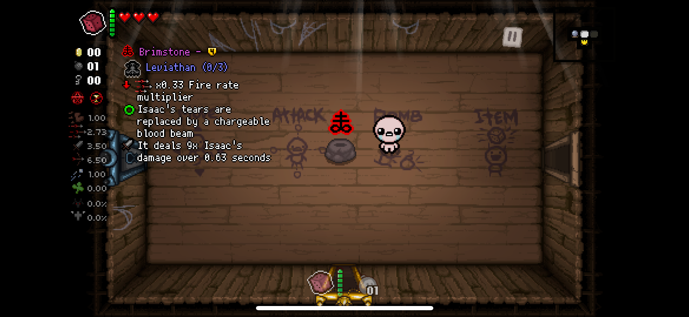

## Install

Choose **one** format, install it, then fully restart Isaac.

| Your setup | Download | What to do |
| --- | --- | --- |
| Rootless jailbreak / ElleKit | `IsaacExternalItemDescriptions-rootless.deb` | Install with your package manager. |
| LiveContainer private app | `IsaacExternalItemDescriptions-LiveContainer.framework.zip` | Extract it, import the framework into an app-specific Tweak Folder, and assign that folder to Isaac. Do not use Global Tweaks. |
| Direct app embedding | `IsaacExternalItemDescriptions-Embedded.zip` | Contains the dylib and complete resource bundle. Use the included [IPA patcher](tools/patch-ipa.sh), then sign the modified app. |

[Detailed installation and signing guide](docs/INSTALL.md). The release also provides a standalone dylib, database, checksums and a full-build archive. **No Isaac IPA or game files are distributed.** Back up your app data before replacing or re-signing an installation.

**Supported:** iOS 15+, ARM64, native Isaac **1.4 / Repentance 1.7.9b.J754**. These native offsets do **not** support Repentance+ or other game executables.

## Use it

- During a run, approach an item to see its description.
- Open **EID ⚙** in the bottom-right from a menu or while paused. It hides during gameplay.
- Pause and open **EID Items** in the top-left to inspect your inventory. Selected descriptions always have a readable dark background.
- Tap a Glitched Crown description to browse its five items. Select D Infinity in EID Items and tap its description to browse all ten dice. The counter is in the top-right; browsing never uses an item or switches the game's die.

Choose any of **20 EID languages**, independently of the game's language. Settings and EID Items follow the selected language immediately. Missing description translations fall back to English. Settings are organized into **Content, Layout, Appearance and Advanced** tabs, each scrollable on small screens. Adjust horizontal/vertical position, **scale (50-400%)**, **text width (100-300%)**, text opacity, background opacity and Name/Icon/Quality/Description visibility. Every slider has its own Reset button. Dataset information is included; upstream attribution remains below in the credits and license files. Default position: **140 px right, 50 px down**. Width never goes below the previous default, and increasing it does not shrink the font.

EID hides during native transitions, fades, boss introductions and cinematics. Ordinary paused descriptions and EID Items remain available.

Descriptions are drawn with original EID bitmap fonts, glyph metrics, inline artwork and layout rules rather than a system description font. Active headers include normal, timed and special charge indicators; unknown pills use a red title with a question-mark icon overlay.

Descriptions now include original EID's **modular text generation** for its supported Repentance objects and character health variants. **Stat icons after arrows** default to on; disable them in Content for original EID's arrow-only appearance. Other inline icons remain visible.

Gameplay is text-only by default, with an optional content-sized background. Pausing temporarily gives every visible description a dark backdrop of at least 72% opacity, including nearby pickups without opening EID Items. Resuming restores your saved background settings.

Original EID's spoiler controls are separate, and all three default to **OFF**:

| Setting | What it reveals |
| --- | --- |
| RNG predictions (spoilers) | Crooked Penny and the next individual Eternal D6 reroll. |
| Void / Black Rune stat previews | The exact future random stat gains from absorption; independent of the RNG setting. |
| Hidden current effects | Already-applied Liberty Cap, Broken Syringe and Mom's Lock effects; also swallowed-only Modeling Clay. |

Spindown's three ID-based results, Flip and Glitched Crown remain enabled as in original EID. Held Modeling Clay remains inspectable without Hidden Info. Updating preserves your language, layout and explicitly saved preferences.

## Everything included

The sections below describe implemented features, not a promise of complete parity with every upstream EID feature.

<details>
<summary><strong>Pickups, rooms, artwork and spoiler protection</strong></summary>

- Collectibles, trinkets, cards, runes, Soul Stones, normal/horse pills and Crane Game prizes. Long descriptions wrap without a fixed character limit.
- All six Dice Room effects; the next Sacrifice Room payout with its live `1/12-12/12` step; Sanguine Bond spike payout probabilities, without pretending to know the next random payout.
- Native collectible/trinket artwork, correct card/rune/Soul Stone/pill frames and actual pill colors. Original EID inline symbols, quality icons, battery/charge indicators, transformation icons, colored text and highlights.
- Active-item headers distinguish normal, timed and special charge types. The original localized single-use warning is shown for its 13 Repentance actives, both on pedestals and in EID Items. Inline collectible/trinket sprites are cropped before scaling so their transparent padding does not make them tiny.
- Curse of the Blind, forced-blind fields and question-mark sprites suppress collectible descriptions.
- Reachable ordinary floor cards/runes are described immediately. Shared-model shop cards and `Options?` cards stay unidentified. Distinctive models, including Credit Card, Black Rune, Rune Shard, Cracked Key, Wild Card and Soul Stones, retain upstream visibility exceptions; Chaos Card is not a unique-model exception.
- Unreachable shared-model cards/runes/pills stay unidentified; flight bypasses the obstruction check. Pills use native identified state, including shop/Options? cases, and otherwise show only a localized unidentified label and color.
- A collection-page reminder marks eligible collectibles never picked up in the selected save slot. This is separate from unlock status and current-run ownership; hidden items, pause entries and read-only/custom runs do not get it.
- Missing Poster offers its Lost-unlock hint only while Lost is locked. Pandora's Box changes its Moving Box unlock reward to Nothing after that unlock, retaining current-floor highlighting. Both read the selected Isaac save, not Game Center.
- Title, artwork and body disappear together after collection. Short rotating pedestals, including Binge Eater, follow the currently visible item rather than the previous half-cycle.

</details>

<details>
<summary><strong>Characters, transformations, floors and game modes</strong></summary>

- Lost/Keeper no-effect and lethal-use warnings, health-type replacements, Birthright descriptions, Eye Drops, Tainted Samson/Uranus, Keeper/IV Bag, tainted Clicker and Dead Cat context.
- Lilith/Tainted Lilith familiar changes; Book of Virtues wisp health, damage and special effects; Judas/Black Judas Birthright passive Book of Belial bonuses.
- Tainted Cain salvage: room-pool rewards, Birthright's `3-8 → 6-16` changes, eligible trinket bonuses, and quest-item/special-context exceptions.
- Native persisted transformation counters plus live ownership keep progress current after pickups, active-item swaps and Continue. Puberty/Adult and identified horse pills are supported. Counts can exceed completion, such as `4/3`.
- Super Bum completion uses the merged familiar's native owner, keeping verified personal progress separate in co-op. Invalid owner data does not invent a partner's completion.
- New-run identity and seed changes reset run-only tracking.
- Greed/Greedier descriptions, applicable room-to-wave wording and no-effect notes. Normal runs do not receive Greed-only warnings.
- Pandora's Box lists floor rewards separately and highlights the current payout in green, including late-game routes, Void, Home and Greed. Strange Key highlights its overriding reward.

</details>

<details>
<summary><strong>Item combinations, current effects and live bonuses</strong></summary>

- Weapon overrides in both directions: warns when a pickup overrides an owned weapon or is overridden by it. Covers the original standard-Repentance priority block, including Dr. Fetus/Trisagion, Epic Fetus, Brimstone, Mom's Knife, Tech X, C Section, Spirit Sword and Azazel.
- Car Battery and Tarot Cloth: changed numbers, special behavior and applicable no-effect combinations.
- Duplicate-copy notes, including meaningful stacking and ineffective extra copies. Diplopia/Crooked Penny can enable prospective-copy notes; owned pause entries do not pretend another copy is being acquired.
- Charge interactions for 9 Volt, 4.5 Volt, Sharp Plug, Vibrant/Dim Bulb and Schoolbag, respecting normal/timed/special charging and primary/pocket-slot rules.
- Additional original combinations, including Black Candle/Cursed Eye, non-stacking damage multipliers, Sacrificial Altar familiars, supported fart/poop effects, Uranus and single-use/mimic interactions. These are reviewed declarative rules, not arbitrary Lua execution.
- Mama Mega shows its repeat-use interaction while a native golden bomb is available; the hint disappears when the bomb is spent or cleared.
- Binge Eater's food-specific stats, temporary damage, speed/healing changes and character conversions. Supported BFFS!/Hive Mind familiar changes avoid applying their shared bonus twice; Forgotten Lullaby includes supported clots and no-effect exceptions.
- PHD/False PHD, Virgo and Lucky Foot use the current player's native pill effect. False PHD's eligible damage/black-heart rewards include horse pills and combined PHD behavior. Removing an item removes its conditional bonus; genuinely learned pill knowledge may remain.
- Golden and swallowed trinkets, Mom's Box multipliers and localized special cases, with gold highlighting. Black Feather shows qualifying copies/trinkets and its current damage bonus.
- Supported luck-sensitive items show their chance at your current Luck.
- Consolation Prize shows normalized-stat and weighted-consumable candidates, tie markers and Bethany charge pools.
- Owned Glyph of Balance shows the selected player's current native pickup priority outside Greed; it does not predict a random reward.
- Purity shows its current aura or inactive state. Modeling Clay shows its already-applied room item, not a future roll. With Hidden current effects enabled, Liberty Cap, Broken Syringe and Mom's Lock show their actually-applied room effect. A failed proc retains the ordinary trinket description; no next-room roll is predicted.

</details>

<details>
<summary><strong>Item previews and touch browsing</strong></summary>

- Spindown Dice shows three eligible results in an arrow-connected chain. Locked, missing, hidden and run-restricted IDs are skipped, not crossed out. Car Battery, Dad's Note stopping and item disappearance are handled.
- Flip shows the native alternate pedestal and its description while retaining blind-item protection.
- With **Void / Black Rune stat previews** enabled, see separate stat-gain predictions from copied native RNG, with single-item, room and purchased-item cases. This control defaults to off and is independent of RNG predictions.
- Abyss shows standard-Repentance locust count, damage, size, speed and special effects. Repentance+ quality scaling is intentionally not used.
- Wild Card shows the recorded effect it will repeat; Vurp! shows the previous pill, with normal/horse-pill and player-specific context.
- The Stars? shows the oldest eligible passive removal, or two with Tarot Cloth.
- Blank Card, Clear Rune and Placebo show applicable mimic charge costs from the installed game's metadata. Unknown pills do not reveal costs.
- Glitched Crown's tap browser keeps each pedestal's selected variant stable while its sprite cycles; rerolls refresh the actual list.
- D Infinity's pause browser has an overview and all ten dice, with their own description, artwork, quality and charge indicators.
- With **RNG predictions** enabled: Crooked Penny's next heads/tails result, including Car Battery's second activation; Eternal D6's next individual pedestal reroll, including D Infinity's actual Eternal D6 mode. Car Battery's Eternal D6 preview explicitly covers only the first of two rerolls, not both.
- Invalid native snapshots suppress a preview instead of guessing. Viewing never consumes charge, advances game RNG, crafts, executes an effect or edits a save.

</details>

<details>
<summary><strong>Pause inventory and Bag of Crafting</strong></summary>

- Browse personal collectibles with duplicate quantities such as `Brimstone ×3`, actual primary/secondary/pocket actives, held cards/runes/pills, equipped trinkets and a separate swallowed/smelted-trinket section.
- Switch native players for Jacob/Esau and co-op. Inventory-dependent descriptions and transformation counters use the selected player, not a combined partner inventory.
- Void's persisted absorbed actives have a separate clickable section, including duplicate counts. Absorbed passives become stats and correctly do not appear there.
- Validated absorbed actives can enable applicable conditional and Spindown/mimic previews while Void is owned, without becoming physical inventory copies.
- Book of Virtues pedestal previews use each applicable player's primary active, not every secondary/pocket active.
- Bag of Crafting shows its ingredient icons and `N/8` count. At 8/8, inspect the game's cached result with its full description, icon and quality. Incomplete/unavailable results are never guessed; viewing does not craft or spend ingredients.
- Inventory/settings controls and the selected pause description hide when gameplay resumes.

</details>

## Screenshots

Actual native iOS gameplay with the 1.0.0 renderer. Open an image for full resolution. The Console button visible in some pause screenshots belongs to the separate Debug Console mod and is not included in EID.

<table>
  <tr>
    <td width="50%"><a href="docs/images/eid-brimstone-transformation.png"></a><br><strong>Original EID look</strong><br>Brimstone with the original pixel font, native artwork, quality and live Leviathan progress.</td>
    <td width="50%"><a href="docs/images/eid-single-use.png">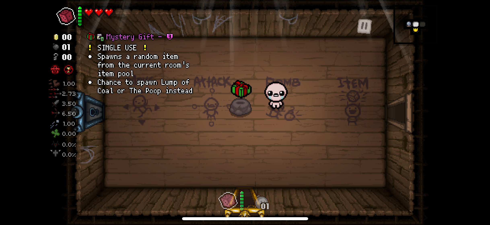</a><br><strong>Single-use means single-use</strong><br>Mystery Gift carries the original SINGLE USE warning, alongside its active-item charge indicator.</td>
  </tr>
  <tr>
    <td width="50%"><a href="docs/images/eid-pandoras-box.png">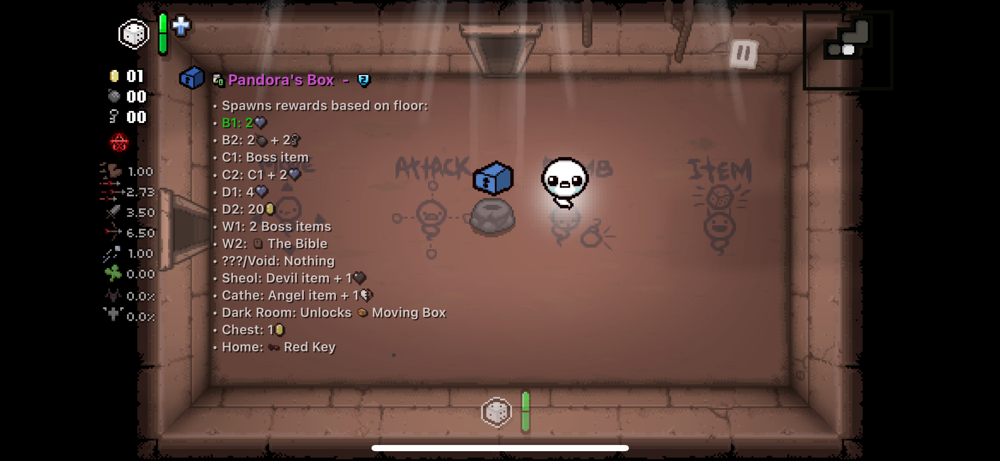</a><br><strong>The floor you are on</strong><br>Pandora’s Box lists its rewards and highlights the current Basement I payout in green.</td>
    <td width="50%"><a href="docs/images/eid-spindown-preview.png">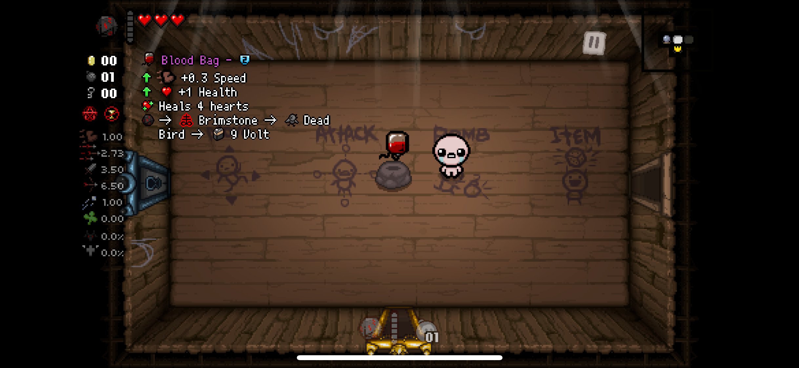</a><br><strong>Follow the reroll</strong><br>Spindown Dice shows three eligible ID-based results, connected by arrows. Unavailable candidates are skipped.</td>
  </tr>
  <tr>
    <td width="50%"><a href="docs/images/eid-lost-breakfast.png">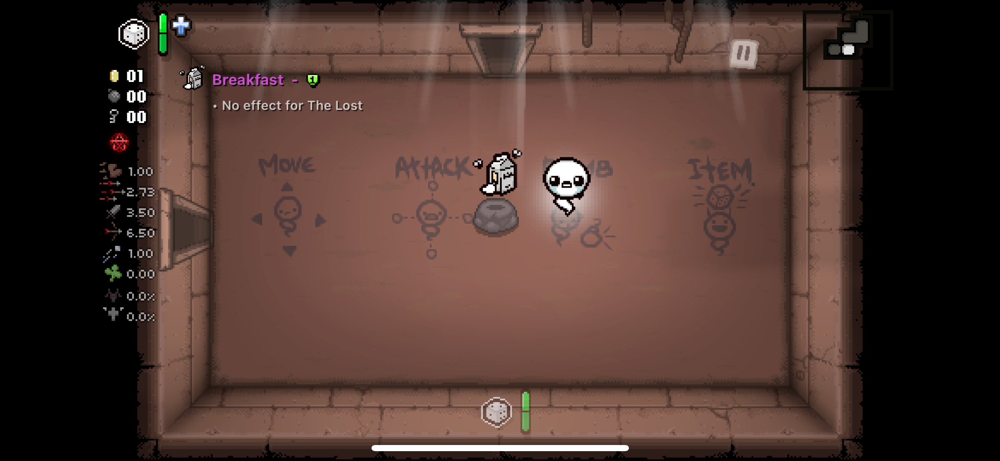</a><br><strong>Your character matters</strong><br>Breakfast says No effect for The Lost instead of suggesting an irrelevant health increase.</td>
    <td width="50%"><a href="docs/images/eid-book-of-virtues.png">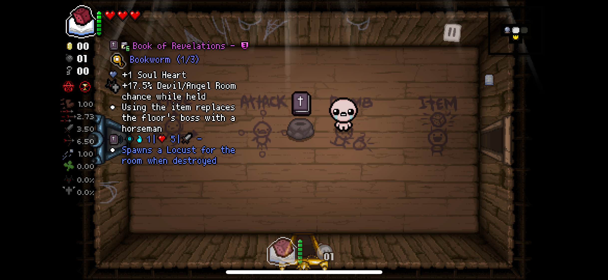</a><br><strong>More than the base description</strong><br>Book of Revelations includes Book of Virtues wisp statistics and special behavior.</td>
  </tr>
  <tr>
    <td width="50%"><a href="docs/images/eid-abyss.png">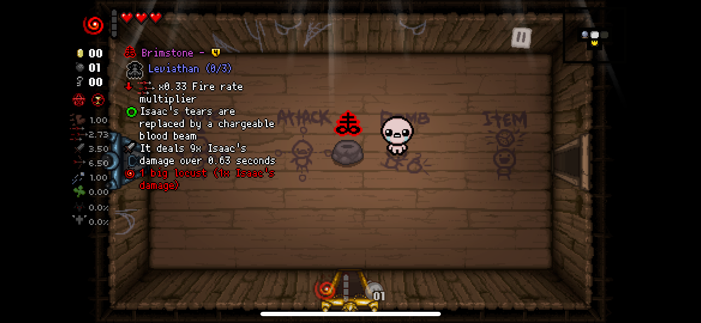</a><br><strong>Know your locust</strong><br>With Abyss held, Brimstone shows its special locust and damage multiplier.</td>
    <td width="50%"><a href="docs/images/eid-pause-d-infinity.png">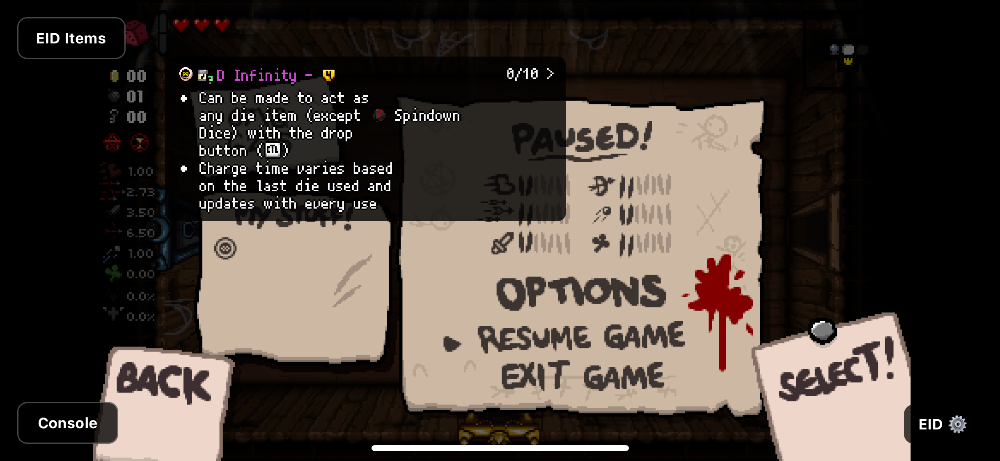</a><br><strong>Inspect without using</strong><br>D Infinity in the pause inventory has a readable backdrop and a tap-to-browse 0/10 counter. Browsing does not change the active die.</td>
  </tr>
  <tr>
    <td width="50%"><a href="docs/images/eid-soul-of-isaac.png">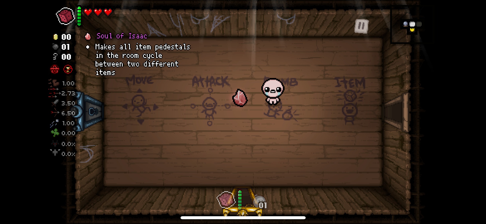</a><br><strong>Soul Stones, correctly drawn</strong><br>Soul of Isaac uses its own icon and description, alongside support for cards, runes and identified pills.</td>
    <td width="50%"><a href="docs/images/eid-unidentified-pill.png">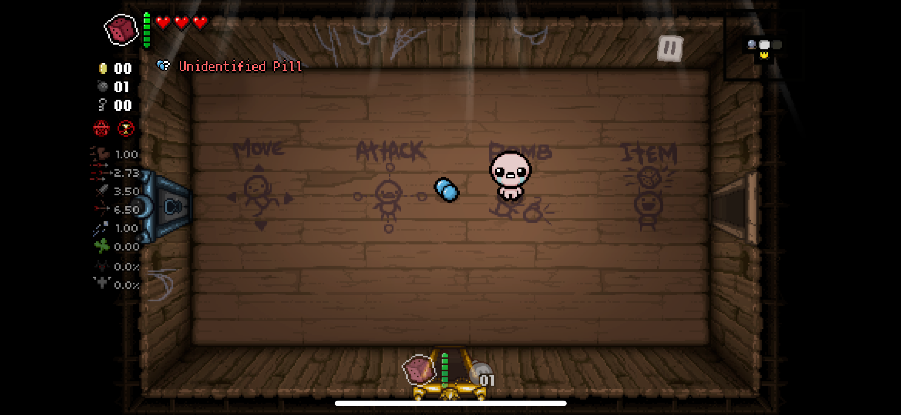</a><br><strong>Keep the mystery</strong><br>An unidentified pill shows its real color, a question-mark overlay and a red title, without revealing its effect.</td>
  </tr>
  <tr>
    <td width="50%"><a href="docs/images/eid-settings-language.png">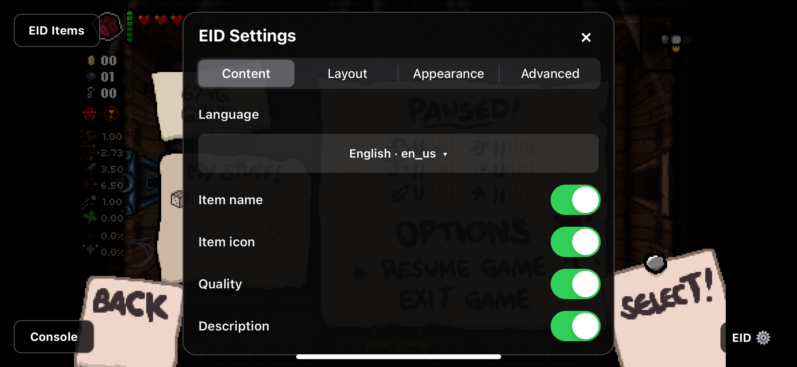</a><br><strong>Choose your language</strong><br>All 20 EID languages are available. Settings and EID Items follow the selected description language.</td>
    <td width="50%"><a href="docs/images/eid-settings-content.png">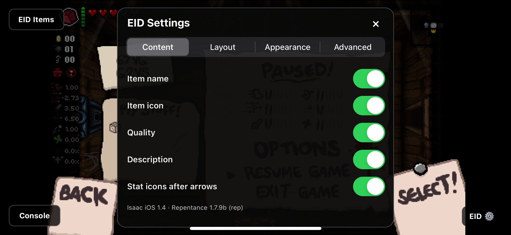</a><br><strong>Keep what you need</strong><br>Control item names, icons, quality, descriptions and stat icons after arrows.</td>
  </tr>
  <tr>
    <td width="50%"><a href="docs/images/eid-settings-layout.png">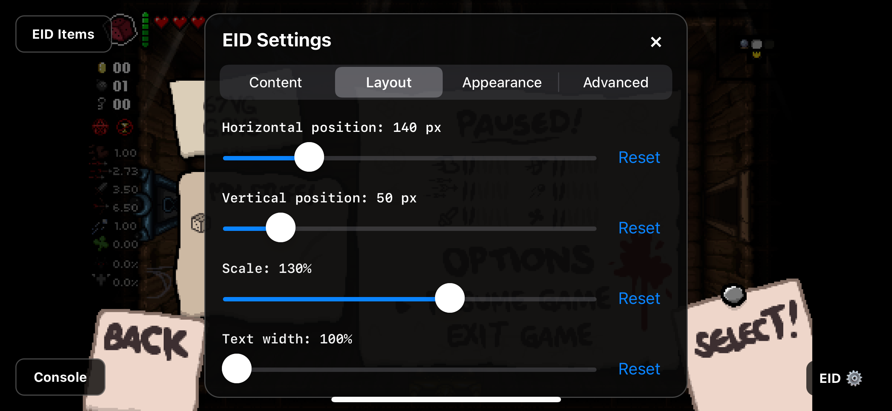</a><br><strong>Fit your screen</strong><br>Adjust position, scale and text width. Every slider has an individual Reset button.</td>
    <td width="50%"><a href="docs/images/eid-settings-appearance.png">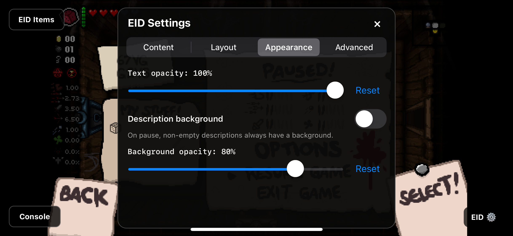</a><br><strong>Make it readable</strong><br>Adjust text and background opacity. Non-empty descriptions always gain contrast while paused.</td>
  </tr>
  <tr>
    <td width="50%"><a href="docs/images/eid-settings-advanced.png">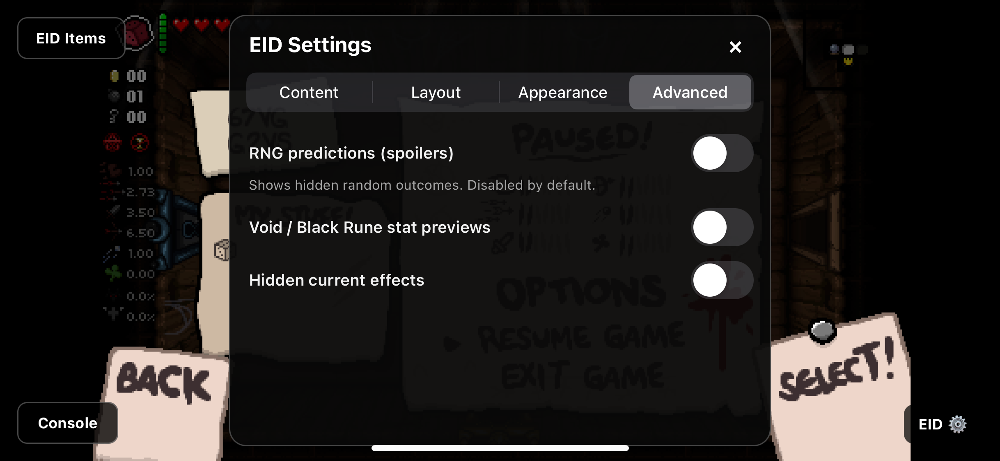</a><br><strong>Spoilers are your choice</strong><br>RNG predictions, Void / Black Rune stat previews and hidden current effects are separate options, all off by default.</td>
    <td></td>
  </tr>
</table>

## Limits and safety

- This is a **native EID adaptation**, not a desktop Lua-mod loader or complete upstream feature port. General recipe search, arbitrary Lua conditions, every co-op/subplayer rule and every RNG prediction are not implemented.
- One nearby eligible description is shown at a time. Browsing a description does not change gameplay or unlock anything.
- Only the verified game executable is supported. Unknown UUIDs fail closed before scanning native entity memory.
- The same dylib uses public iOS frameworks in every loading mode: no jailbreak-only library, JIT, daemon or synthetic joystick touches. LiveContainer startup waits for Isaac's real render view and advancing frames.
- Re-signing may change the app identifier, container, Keychain access and receipt behavior. The mod does not bypass DLC ownership, StoreKit or purchase checks.
- The user confirmed the latest changes working on the development phone. Not every character, language, co-op combination or loading mode has been exhaustively replayed.

## Build and technical details

Requires macOS, Xcode's iOS SDK, Python 3, `dpkg-deb`, and an [original EID checkout](https://github.com/wofsauge/External-Item-Descriptions) for attributed visual resources.

```sh
make release EID_SOURCE=/path/to/External-Item-Descriptions
```

Outputs go to `dist/` and `packages/`. The single GitHub workflow builds all formats, verifies their contents and publishes tagged releases. Release descriptions come from the matching [changelog](CHANGELOG.md) entry, without repeating the release title.

[Rendering and resource attribution](docs/RENDERING.md) · [Installation](docs/INSTALL.md) · [Native layout](docs/NATIVE_LAYOUT.md) · [EID parity and remaining scope](docs/EID_PARITY.md)

## Credits

Huge thanks to **[wofsauge](https://github.com/wofsauge)** and every original [External Item Descriptions](https://github.com/wofsauge/External-Item-Descriptions) contributor and translator. [Original Steam Workshop mod](https://steamcommunity.com/sharedfiles/filedetails/?id=836319872).

EID-derived descriptions and resources are included with the original author's permission and remain attributed in [Third-party notices](THIRD_PARTY_NOTICES.md). Game artwork is read from the installed game.

Unofficial; not affiliated with Nicalis, Edmund McMillen, Valve or the EID maintainers. No game application, save, credential or purchase bypass is included. This bridge's source uses the [MIT License](LICENSE).
